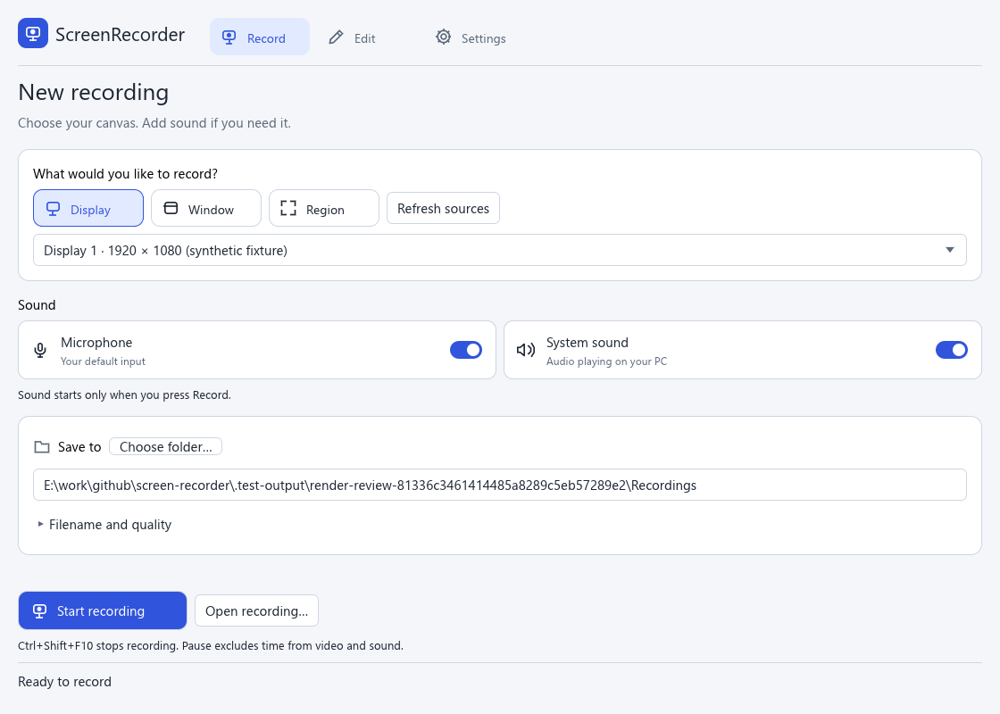
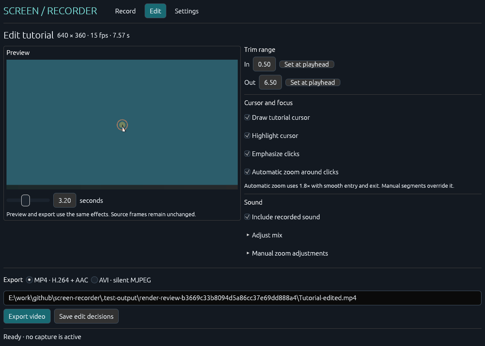
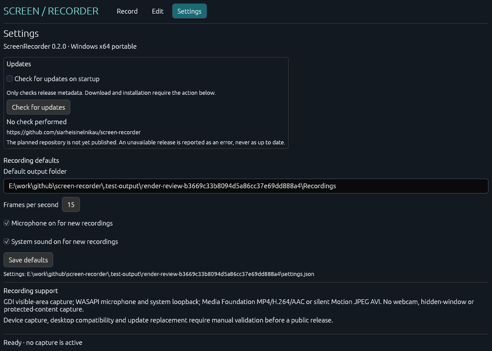

# ScreenRecorder

A Windows-first recorder for readable tutorials: capture a display, visible window or a precise region, then trim the clip and add cursor emphasis and smooth zoom. Independent MIT-licensed implementation, with original UI and code. Inspired by the workflow of [Screen Studio](https://screen.studio/); no affiliation or shared assets.

**Version 0.3.0 adds six interface languages and a saved light/dark appearance setting.** Language and theme changes apply immediately in Settings. The existing WASAPI, MP4 and CPU/GDI recording workflow is preserved. This revision was verified without launching the GUI or accessing screen/audio devices; earlier visual/runtime evidence is identified by version below.

## Capabilities

| Area | Implemented in 0.3.0 |
| --- | --- |
| Interface | English, Russian, French, German, Spanish and Italian; immediate saved language and light/dark theme controls |
| Sources | Explicit display, window or numeric region selection; physical virtual-desktop coordinates |
| Recording | Windows GDI capture, 5–30 target fps, pause/resume, stop, visible state and Ctrl+Shift+F10 stop shortcut |
| Storage | Append-only `.srec` video and separate timestamped audio journals; recovery of complete frames/packets after an incomplete write |
| Editing | Scrubbable preview, in/out trim, cursor arrow and highlight, expanding click rings, automatic 1.8× click zoom, editable 1–3× zoom segments |
| Export | Windows Media Foundation MP4/H.264 + AAC, or silent Motion JPEG AVI; trim, cursor/zoom effects, cancellation, progress and no overwriting |
| Updates | Installed version, manual check, background startup check with saved opt-out, explicit download/install/restart, checksum and PE architecture verification |
| Audio | Optional default microphone and default system-output loopback via shared-mode WASAPI; separate gain controls and a synchronized stereo mix for MP4 |

No webcam, timeline/audio playback, hidden-window recording, HDR color management, protected-content capture or external-video import is provided. `.srec` plus its sidecars is the editable recording; MP4 is the default shareable output. No external FFmpeg, drivers, browser extensions, services, models or API keys are required. The H.264/AAC encoders are Windows components, not bundled third-party codecs.

## Use on Windows

The package is **`ScreenRecorder-v0.3.0.exe`**, Windows x64. Build it using the commands below or obtain the versioned executable from the canonical repository releases. Intended requirements: Windows 10/11 with Media Foundation/H.264/AAC and Windows GDI desktop presentation. Windows N installations need Media Feature Pack; this is not installed by the app. Actual clean-machine and hardware compatibility remain to be verified.

1. Launch the portable executable manually. In **Record**, select Display or Window and press **Refresh sources**, or enter a Region using physical pixels. Choose a source explicitly.
2. Under **Sound**, opt into **Microphone**, **System sound**, both or neither. Both are off by default. Set an absolute output folder. Use **Choose folder…** or edit the path. The default filename is generated automatically; **Filename and quality** exposes those optional controls. The folder is created only after **Start recording**.
3. Press **Start recording**. Pause and resume from the app. **Stop and save** or **Ctrl+Shift+F10** finalizes the project. Closing the app requests stop and waits for finalization.
4. The saved project opens in **Edit**. Scrub the preview, set trim in/out and choose **Clean**, **Guided** or **Focus**. **Customize effects** keeps the individual cursor/highlight/click/zoom controls available. **Edit zoom timing** exposes timing and normalized focus X/Y from 0 to 1; the first matching manual segment overrides automatic zoom. **Sound levels** exposes gain only for tracks that exist. Preview does not play audio.
5. **Save edit decisions** writes a separate `.edit.json`; source media stays unchanged. Select MP4 or silent AVI, choose a new absolute destination matching that format, and press **Export video**. MP4 includes audio when **Include recorded sound** is selected. Export does not implicitly save edit decisions.
6. To resume later, press **Open recording…** beside Start and choose a `.srec` project in the Windows file picker. If an edit sidecar is malformed, correct or rename that sidecar before reopening; the source project is retained.

Keep the selected window visible and unoccluded. Window capture follows its visible screen rectangle, including its frame; it is not isolated window capture. Resizing, minimizing, closing, or moving any part outside the virtual desktop stops recording with a recoverable project. Display recording can include the recorder window; place the controls outside the selected region when needed. There is no hidden capture or global key logging. Cursor position and left-button state are sampled only during an explicitly started, unpaused recording; short clicks between samples may be missed. The stop key chord is also checked while paused.

Capture sizes are limited to 64–4096 × 64–2160 pixels. A video journal is limited to 200,000 frames and 16 GiB; audio journals have separate limits below. AVI 1.0 exports stop before 2 GB; trim shorter segments for large recordings. MJPEG files can be substantially larger than H.264 files. Slow capture/encoding reduces the sampled frame rate; timestamps preserve elapsed time and export repeats previous frames to maintain duration. Pause time is excluded.

## Sound and MP4 behavior

The app uses the default Windows capture endpoint for microphone input and the default render endpoint for system loopback. Loopback captures the whole default output mix, including other applications; it is not per-application audio. No audio endpoint enumeration or activation happens until Start. There is no microphone monitoring, test-tone playback or automatic Windows privacy/volume change. Microphone access must already be permitted by Windows. Failure of a selected endpoint aborts recording rather than silently dropping that track. Device removal, timestamp errors, capture overrun or an unsupported mix format stops recording with an error and retains completed data.

Video and audio share a performance-counter timeline. Pauses stop audio clients; packet intervals crossing pause/stop boundaries are clipped, and resumed time excludes the pause. Native float32 or PCM16/24/32, 8–192 kHz, one to eight channels with recognized speaker layouts is converted to 48 kHz stereo using linear resampling. Missing intervals export as silence. Two tracks mix at half gain each, followed by clipping protection; individual gains range from 0 to 2.

Keep `Recording.srec.mic.saudio` and `Recording.srec.system.saudio` beside `Recording.srec` when moving a project. These float PCM journals can be large: about 23 MB/minute per track, with limits of 8 GiB and 1,000,000 packets per track. The recording reader recognizes complete packets and warns on a truncated tail. Existing video-only 0.1 projects and edit files remain readable. An existing audio sidecar prevents reuse of the same recording filename.

MP4 uses the Windows software H.264 and AAC transforms with hardware transforms disabled. Odd dimensions are padded by replicating the last row/column to even dimensions. Encoding/finalization errors retain source media and do not publish an incomplete MP4. An adjacent `.partial.mp4` is created exclusively and removed on handled cancellation/failure; an existing partial is preserved. Finalization runs on the worker and may take time inside Windows APIs. AAC priming/padding can extend decoded audio slightly beyond the video; the 0.3-second fixture decoded to 0.32 seconds of silence. Long-session synchronization and actual devices still need manual checks.

## Language and appearance

Open **Settings → Appearance and language**. Choose **English**, **Русский**, **Français**, **Deutsch**, **Español** or **Italiano**, and choose **Light** or **Dark**. Both choices apply immediately and save automatically to the existing settings file; no restart is needed. English and Light remain the defaults for existing settings that do not contain these preferences. Recording options and the startup-update opt-out are preserved. Unknown future language/theme values fall back safely.

All application labels, help, recording/export status messages, update actions and native file-picker titles use the selected language. Window titles, filenames, paths and technical OS/codec/network details retain their original content. Named message parameters are inserted without translating or interpreting user values. Custom buttons grow for translated text and sound switches wrap their descriptions. Both palettes cover the custom controls, standard widgets and the native title bar where Windows supports those attributes.

## Version 0.2.0 application-generated views (historical)

**These screenshots predate the language/theme controls and show the previous light interface.** New v0.3.0 main/settings screenshots and runtime dark-mode review are pending because repository instructions prohibit application launch and screenshot capture in this session. These are real Record/Edit/Settings components rendered by the packaged EXE's bounded `--render-review` mode. They use synthetic media and selected sound options as fixtures; no window, desktop capture, audio device, network or computer use is involved. The same CPU rasterizer as the normal window draws the actual egui 0.37 meshes/font textures. Native GDI presentation, window chrome and interactions require separate evidence. New installations still leave both sound options off.







The v0.2.0 views use neutral light surfaces, labeled vector icons and compact sound switches. The current interface also has a coordinated dark palette. The normal window now uses CPU rasterization and Windows GDI. The [isolated native check](docs/RENDER_PERFORMANCE.md) completed visible/idle/minimized/restore with no idle frame generation; broader input/device checks remain pending.

See [render review evidence](docs/RENDER_REVIEW.md) for the narrower/high-DPI/error views, defects found and the separate native rendering measurements.

## Build and safe verification

Use the installed Rust **1.96.1** MSVC toolchain (minimum 1.95) and Microsoft C++ build tools. All Cargo output stays in this repository's `target`; concurrency is capped at two jobs.

```powershell
# Run from E:\work\github\screen-recorder
.\scripts\verify.ps1 -Offline -NativeMedia
.\scripts\package.ps1 -Offline
```

Omit `-Offline` on a machine that needs dependencies. `-NativeMedia` opts into the bounded synthetic Media Foundation encoder/decoder test; it never constructs a capture endpoint or plays media. Without that switch, unit tests and compilation still run. Packaging builds the static-CRT `x86_64-pc-windows-msvc` executable without starting it and creates `dist/ScreenRecorder-v0.3.0.exe`, `dist/SHA256SUMS.txt`, `dist/LICENSE.txt` and `dist/THIRD_PARTY_NOTICES.txt`. Keep the [license and notices](docs/THIRD_PARTY.md) with the unsigned executable. No step publishes anything.

The optional fixture generator also never accesses a desktop or device:

```powershell
cargo run --offline --locked --example synthetic --jobs 2
python .\scripts\inspect-fixtures.py
python .\scripts\inspect-mp4.py
python .\scripts\inspect-package.py # Reads PE headers/imports/checksum; rejects GPU renderer imports
.\scripts\inspect-icons.ps1 # Loads icon resources as data, never executes the EXE
.\scripts\render-review.ps1 # After packaging; finite CPU-only rendering, no window/devices/network
# Explicit opt-in: opens its own isolated CPU/GDI test window for about 25 seconds
.\scripts\diagnose-render.ps1
```

It creates an artificial project, two silent audio journals, edited MP4/AVI and a silent PCM WAV under `.test-output/synthetic-*`. The Python parsers independently check RIFF/ISO BMFF structure, codecs, sample counts and durations without playback. Tests also cover journal recovery, pause mapping, PCM conversion, cancellation, source/output preservation, settings and update verification. See [verification](docs/VERIFICATION.md) for results and deferred checks.

`render-review.ps1` separately invokes the packaged EXE with a new absolute output directory, a 30-second internal deadline and a 45-second external timeout. Six UI scenes use three finite passes each. PNGs, a scene manifest and process measurements are written under `.test-output/render-review-*`; existing output is refused. The capture path skips normal startup/settings/update logic and asserts that no workers were started. Primary recording/export button bounds must fit each viewport. It is a static layout review, not an idle/hidden measurement. `diagnose-render.ps1` separately opts into a finite isolated native window: visible idle, explicit invalidation, minimized idle and restore. It disables capture/export/update dispatch, never reads screen pixels or opens audio endpoints, samples process CPU and actual CPU-raster/GDI-present timings, and closes automatically. Only its owned disposable PID can be terminated on timeout. See [native renderer evidence](docs/RENDER_PERFORMANCE.md).

## Data and updates

Projects and edits are stored in the chosen folder. Settings are stored in `%LOCALAPPDATA%\ScreenRecorder\settings.json`. Recording and edit data are separate from the executable and are preserved during updates. Nothing uploads recorded media. A startup update check sends a normal public HTTPS request to GitHub only if **Check for updates on startup** is enabled; disabling it prevents that request on subsequent launches. Checks do not download application payloads.

The canonical repository is [siarheisinelnikau/screen-recorder](https://github.com/siarheisinelnikau/screen-recorder). A missing release, API rate limit or network error is reported as unavailable, not as an up-to-date installation. Manual checks remain available when startup checks are off.

**Download and install (restarts app)** downloads only the newer stable x64 portable asset and requires `SHA256SUMS.txt`. Downloads are size-bounded, verified against the digest and checked for an x64 PE header. A helper waits for the old process to exit, backs up the executable, replaces it and relaunches the same installed path. A failed replacement attempts to restore the original. The application folder must be writable. Update staging folders `.screenrecorder-update-*` retain the previous executable and any error log for manual recovery; they are not automatically deleted. Install failures are recorded in staging and `%LOCALAPPDATA%\ScreenRecorder\update-error.txt`, which is displayed on the next launch. Replacement/restart, interrupted downloads and real networking still require manual validation. Digests are fetched over HTTPS from the same official release; this is not an independent code-signing scheme.

Read the [architecture](docs/ARCHITECTURE.md), [design decisions](docs/DESIGN.md), [manual validation checklist](docs/VERIFICATION.md) and [0.3 release notes](docs/RELEASE_NOTES_v0.3.0.md) before distribution.


## Shared updater and rendering audit

Keep `rust-auto-updator` beside this checkout: builds now use `../rust-auto-updator/crates/rust-auto-updator`. CI/package environments need both siblings; this change does not publish a registry package. ScreenRecorder retains product configuration and UI while release selection, HTTPS, cancellable download/progress, checksum/PE validation, staging, replacement, rollback and cleanup live in that shared core. Startup opt-out, manual checking and user-initiated installation are preserved. Assets remain `ScreenRecorder-vVERSION.exe` with `SHA256SUMS.txt`.

A verified download is owned by a `Prepared` value. Cancelling or closing before handoff drops it and removes known staging files. A successful handoff closes the app through its normal shutdown path; the helper waits for exit before replacement. The new executable handles `--apply-update` before UI startup and `--cleanup-update` after restart. Older installed versions retain their own copied helper for the transition to this protocol.

The source audit confirms CPU rasterization -> retained bitmap -> softbuffer Win32 GDI, without a GPU context. Finite repaint deadlines return to `Wait`; hidden/minimized paths run logic without layout/rasterization/presentation. Unchanged expose events reuse the retained bitmap. The application intentionally has no tray mode. Its executable ICO contains 16, 20, 24, 32, 48, 64, 128 and 256 pixel artwork; the runtime window/taskbar icon uses the matching PNG.

This change was checked with fixture tests and executable resource loading without launching the application. Previously recorded runtime measurements in `docs/RENDER_PERFORMANCE.md` apply to their recorded binary only. Visible/idle/minimized/restore frame counts, CPU/GPU load, taskbar integration and perceptual smoothness were not reverified for this revision because local instructions prohibit GUI launch.
