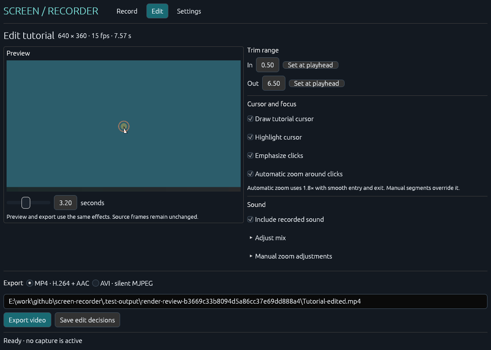

# Application-generated render review

The light interface revision was rendered and inspected on 2026-11-01. These are actual application components, not a browser mockup or desktop recording. The exact packaged EXE is `ScreenRecorder-v0.2.0.exe`, SHA-256 `d0e17dd6cefb4b13e4df0019a0cbdb203b9a9fa7690721954aaf53199d301809`, source `a6c1ec1`.

## Scope and observed changes

`--render-review` runs before normal settings/updater/window startup. It uses synthetic video and silent audio, the real `RecorderApp::show`, egui 0.37 fonts/layout, and the **same CPU rasterizer/mesh adapter as the production window**. It does not create a window, read desktop pixels, activate an endpoint or start media/update workers. GDI presentation and native lifecycle are verified separately in [the performance record](RENDER_PERFORMANCE.md).

All six final PNGs were opened and inspected:

| Scene | Logical size | PNG size / scale | Review |
| --- | --- | --- | --- |
| [Record](screenshots/record.png) | 1120 × 800 | 1120 × 800 / 100% | Source selection, neutral sound switches and save folder fit without body scrolling; Start/Open remain visible |
| [Editor](screenshots/edit.png) | 1120 × 800 | 1120 × 800 / 100% | Preview, compact trim, three effect presets and persistent export controls |
| [Settings](screenshots/settings.png) | 1120 × 800 | 1120 × 800 / 100% | Recording defaults and updates form two clear groups; support details are collapsed |
| [Error](screenshots/record-error.png) | 880 × 650 | 1320 × 975 / 150% | Error and recovery text appear above the scrolling body; Start remains visible |
| [Narrow editor](screenshots/edit-narrow.png) | 880 × 650 | 880 × 650 / 100% | Editing content scrolls; export action stays visible |
| [Scaled settings](screenshots/settings-scale.png) | 880 × 720 | 1320 × 1080 / 150% | Long paths and switch labels fit; lower content scrolls |

Sound is deliberately selected in fixtures to expose both controls; new-install defaults remain off. The error is synthetic and does not indicate a real microphone access attempt. Long repository-local fixture paths intentionally exercise field widths.

The review replaced dark teal colors with cool neutral surfaces, graphite text and a single blue action color. Sound switches keep neutral surfaces, with blue confined to their on-state tracks. Source/style selection and navigation use restrained blue selection. Segoe UI is loaded from the installed Windows font folder, with bundled egui fonts as fallback; proprietary Windows font files are not redistributed. Icons are vector strokes, not font glyphs. No decorative animation or recurring timer was added.

Cursor settings now start with **Clean / Guided / Focus** presets. All four individual effects remain under **Customize effects**; gains and manual zoom timing expand separately. Native folder/project pickers are implemented for explicit user actions and disabled in isolated modes. They were compiled but not opened during this review. The keyboard switch activation test uses synthetic egui input only.

| Before | After |
| --- | --- |
|  |  |

Earlier layout fixes remain: primary actions outside the scrolling body, errors near navigation, full-width paths, no unsupported Start glyph. Actual primary-button bounds are asserted against every relevant viewport. The [manifest](screenshots/manifest.json) records dimensions, triangles, three passes per scene, scroll metrics and button bounds.

## Legibility and icon evidence

Contrast calculated from the implemented tokens: text/background **14.21:1**, secondary/background **5.23:1**, white primary-button text **6.12:1**, selected blue text **5.08:1**, slider track/white **3.36:1**. These checks cover those pairs, not a claim of complete accessibility certification. Focus rings and labels accompany icons/switch state.

The packaged icon was loaded as a Windows image resource without executing the EXE and rendered at 16, 20, 24, 32, 48, 64, 128 and 256 pixels. Native 16/32/256 results were visually inspected for alpha, clipping and legibility. The final EXE is configured with the same artwork as its winit window icon. Resource validation does not certify Explorer/taskbar cache behavior or OS shell appearance.


## Bounded execution

Final headless PID **6616**, exit **0**; **634 ms** wall, **250 ms** process CPU, sampled peak working set **37,978,112 bytes**. Six scenes × three passes = 18 intentionally requested passes. This finite fixture/render workload is not idle CPU or a throughput guarantee. [Raw process measurements](screenshots/process.json) retain executable identity.

The runner has a 30-second internal / 45-second external deadline, refuses existing output and can terminate only its own disposable PID. No forced termination occurred. The shared numeric texture adapter explicitly consumes egui 0.37 deltas after transfer, including debug builds.

```powershell
.\scripts\package.ps1 -Offline
.\scripts\render-review.ps1
.\scripts\inspect-icons.ps1
```

Native chrome, 200% OS DPI, mixed monitors, keyboard traversal beyond the synthetic switch check, expanded-state coverage, screen readers and native picker interaction remain separate manual checks. No computer use was performed.

The later native-caption consistency fix (`28a4ebe`) leaves these client-area components unchanged. Its DWM light-mode and lifecycle checks are recorded separately in [RENDER_PERFORMANCE.md](RENDER_PERFORMANCE.md); these images are not evidence of the native title bar.
