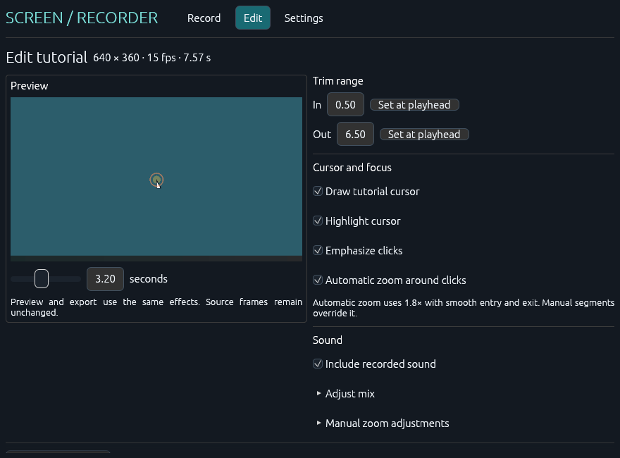
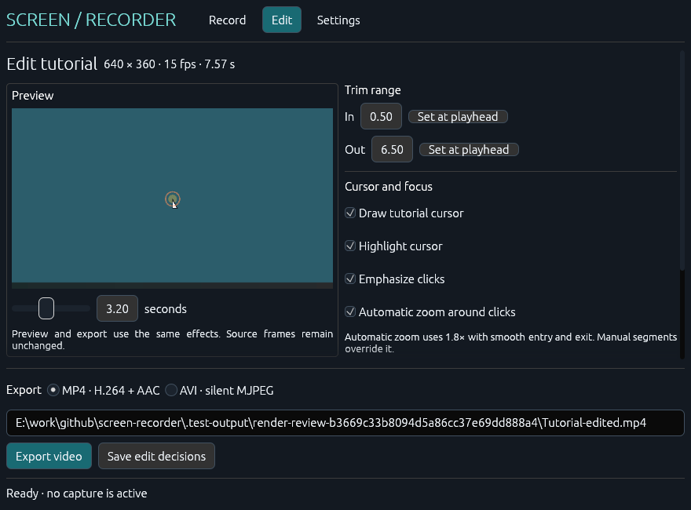

# Application-generated render review

The previously missing static review was completed on 2026-10-31. This is actual application component rendering, not an HTML recreation, hand-drawn mockup, AI image or desktop screenshot. All final PNGs were opened and visually inspected after the fixes.

## Exact scope

The packaged `ScreenRecorder-v0.2.0.exe` recognizes `--render-review` before GUI, preference, update/helper or capture startup. It constructs isolated synthetic fixtures and calls the same `RecorderApp::show`, egui 0.37 layout, theme, fonts and editor compositor used by the ordinary window. Actual tessellated meshes, clipping and texture pixels are passed through a numeric compatibility adapter to `egui_software_backend` for CPU rasterization. No old egui UI context or second interface is constructed.

The production window still presents with Glow/OpenGL. These CPU fallback captures do not verify its gamma/presentation parity, native chrome, OS integration, input behavior or settled idle/minimized/restore load. The normal desktop rendering gate remains incomplete. No window, computer use, screen/audio device or network operation was used for this review.

## Screens inspected

| Scene | Logical size | PNG pixels | Scale | Observed result |
| --- | --- | --- | --- | --- |
| [Record](screenshots/record.png) | 1120 × 800 | 1120 × 800 | 100% | Primary Start action and status visible; real controls with a synthetic selected source |
| [Edit](screenshots/edit.png) | 1120 × 800 | 1120 × 800 | 100% | Preview, editing controls and export footer fit |
| [Settings](screenshots/settings.png) | 1120 × 800 | 1120 × 800 | 100% | Long output path now spans available width |
| [Error](screenshots/record-error.png) | 880 × 650 | 1320 × 975 | 150% | Error is visible above scrolling content; Start/status remain visible |
| [Narrow Edit](screenshots/edit-narrow.png) | 880 × 650 | 880 × 650 | 100% | Export controls remain visible; overflowing edit options scroll with a visible scrollbar |
| [Scaled Settings](screenshots/settings-scale.png) | 880 × 720 | 1320 × 1080 | 150% | Defaults/save and status remain readable; additional support text scrolls |

Fixtures select both sound options to expose their controls; the real new-install defaults remain off. The preview image is generated from synthetic frames through the real editor compositor, not captured from a desktop. The error is an explicit fixture state, not a claim that a microphone was opened or denied.

## Defects found and corrected

- At 880 × 650 the export action was below the visible area. Recording/export actions and status now live outside the scrolling body in a persistent footer. Capture mode checks the actual primary response rectangles against each viewport and fails if clipped.
- Recording errors were placed below the body and could be invisible. The bounded error panel now appears immediately below navigation.
- Settings used a fixed narrow output-path field despite available space. It now expands across the view.
- The Start button's circle glyph rendered as a missing-character square. The unsupported glyph was removed from action/status labels.
- Overflow was hard to discover without hover. Scrollbars are now solid and visible when needed; their content/viewport sizes are recorded in the manifest.

| Minimum editor before | Minimum editor after |
| --- | --- |
|  |  |

[Original Settings capture](screenshots/before-settings.png) shows the former narrow path field. Baseline captures came from the same headless component pipeline in intermediate executable SHA-256 `e58c67a675ab839d3c150cf2ee714c1bd9f8466e0717a256f2949aa20b097cae`.

## Bounded execution evidence

Final source: `6c6d1af`. Final executable SHA-256: `c1fd436a3e78db2ab819b22f3eeabc66ce46f4757afe72282ded6a6e22534450`. The [manifest](screenshots/manifest.json) records each scene's dimensions, scale, three-pass count, triangles, primary bounds and scroll content/viewport sizes.

The owned review process (PID 57328) exited normally with code 0 after 461 ms wall time, using 187.5 ms process CPU and a sampled maximum working set of 38,486,016 bytes. That is approximately 40.67% of one logical core **during a finite rendering/fixture workload**, not settled idle CPU. Six scenes × three passes = 18 deliberately requested passes. Internal scene/fixture work took 208 ms. These small observations are not a throughput guarantee or normal-renderer benchmark.

The runner sets a 30-second internal and 45-second external deadline, uses a fresh output directory and hidden/no-window process flags, and can terminate only its own disposable review process on timeout. No timeout or forced termination was needed. The capture asserts that no media/update workers or recording control were created. It refuses existing output directories and unsupported GPU callbacks.

## Repeat

```powershell
.\scripts\package.ps1 -Offline
.\scripts\render-review.ps1
```

Use only the current executable that implements this flag; it is not a generic screenshot option. Review fresh PNGs with a local image viewer, then update these assets and their manifest together. The pipeline is also configured in CI; CI itself has not been run remotely in this session. Unit checks, Clippy, formatting and the synthetic Media Foundation round trip continue to pass. Future live-window work must separately apply the performance gate and validate normal presentation/idle/hidden states.
